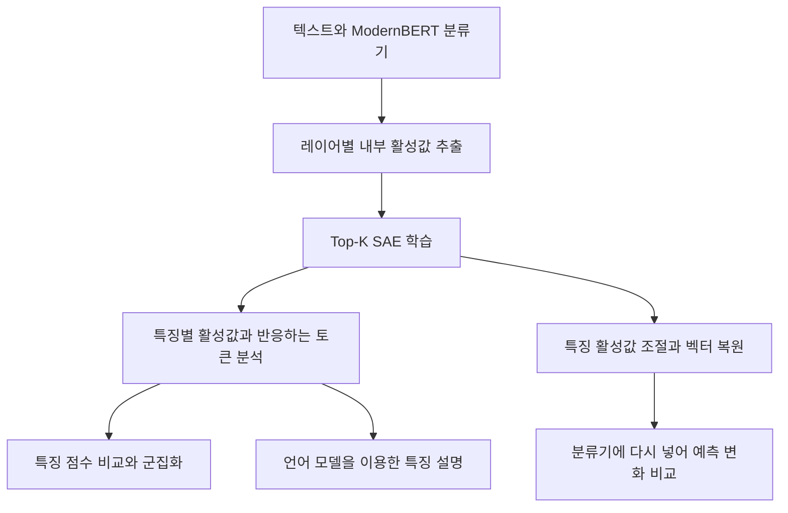

# ModernBERT Sparse Autoencoder

> Summarized by AI Agent (codex/gpt-6.1-sol)

AI 생성문 탐지에 쓰이는 ModernBERT 분류기의 내부 표현을 Sparse Autoencoder(SAE)로 분석한 실험 코드입니다. 모델이 어떤 문장 패턴에 반응하는지 살펴보고, 그 특징을 조절했을 때 분류 결과가 어떻게 달라지는지 확인하고자 했습니다.

분류 확률만으로는 모델이 문장의 어느 부분을 판단 근거로 삼았는지 알기 어렵습니다. 이 프로젝트에서는 모델 내부의 벡터 표현인 residual stream을 SAE로 분해하고, 여기서 얻은 특징이 어떤 단어와 문장에 반응하는지 분석했습니다. 이어서 특징의 활성값을 직접 바꾸는 steering 실험으로 분류 결과의 변화를 살펴봤습니다.

## 실험 흐름



### 내부 표현을 특징으로 분해하기

먼저 분류기의 여러 레이어에서 토큰별 활성값을 추출합니다. SAE는 이 벡터를 더 많은 차원의 특징 공간으로 인코딩한 뒤 원래 벡터로 복원하도록 학습합니다. Top-K 활성화는 각 토큰에서 상위 K개 특징만 남기는 방식으로 희소성을 부여합니다. 분류기는 고정한 채 SAE를 별도로 학습합니다.

레이어, 특징 공간의 크기, K 값을 바꿔가며 복원 오차와 특징의 활성화 양상을 비교할 수 있습니다. 학습 코드에는 입력 정규화, 디코더 가중치 정규화, 활성화되지 않는 특징을 위한 보조 손실도 포함돼 있습니다.

### 특징이 무엇에 반응하는지 살펴보기

각 특징에 대해 반응이 강한 문장과 토큰을 모으고, 문장별 점수를 계산합니다. 이를 정답 라벨과 모델 예측에 대조해 사람 글과 AI 생성문 중 어느 쪽에 반응하는지, 얼마나 자주 나타나는지, 모델의 판단과 어떤 관계가 있는지 살펴봅니다. 비슷한 특징을 묶는 군집화와 토큰 워드클라우드 분석도 포함합니다.

특징 설명 생성 코드는 문장과 토큰 활성값을 언어 모델에 전달해 공통된 패턴을 짧은 구문이나 문장으로 요약합니다. 이 설명은 특징을 읽고 비교하기 위한 해석 후보로 사용합니다.

### 특징을 조절해 예측 변화 확인하기

Steering은 선택한 특징의 활성값을 0 또는 지정한 값으로 바꾸고, SAE 디코더로 복원한 벡터를 분류기의 해당 레이어에 다시 넣는 실험입니다. 같은 입력에 대해 개입 전후의 분류 확률을 비교합니다. 이때 예측 변화에는 특징 조절뿐 아니라 SAE의 복원 오차도 영향을 줄 수 있습니다.

Streamlit 화면에서는 특징별 통계와 반응하는 문장, 토큰별 점수, 직접 입력한 텍스트의 특징 활성값, steering 전후의 예측을 확인할 수 있습니다.

## 코드 구성

| 경로 | 내용 |
| --- | --- |
| `src/activations.py`, `scripts/extract_rs.py` | 분류기 내부 활성값 추출과 학습 데이터 로딩 |
| `src/sae.py`, `src/train.py`, `src/conf/` | SAE 구현, 학습, Hydra 설정 |
| `src/features.py`, `src/sae_feature_handler.py`, `src/utils/` | 특징 기록, 점수 계산, 통계와 군집 분석 |
| `src/auto_explainer/`, `scripts/run_explain.py` | 언어 모델을 이용한 특징 설명 생성 |
| `src/sae_adapter.py`, `src/frontend/` | 특징 개입과 탐색 화면 |
| `notebooks/` | SAE 설계 확인, 특징 분석, 설명 생성, steering 등 탐색 과정 |

노트북은 탐색 과정의 코드이며, 일부 셀은 앞선 분석에서 생성한 파일이나 중간 변수를 사용합니다.

## 실행

Python 3.11 이상을 사용합니다. 직접 준비한 ModernBERT 분류기와 텍스트 데이터가 필요합니다. 저장소 루트에서 설치하고 `.env.example`을 `.env`로 복사해 모델과 데이터 경로를 지정합니다.

```bash
python -m pip install -e '.[frontend,explain,notebooks]'
cp .env.example .env
```

모델과 데이터 경로를 지정한 뒤 활성값을 추출하고 SAE를 학습합니다.

```bash
python -m scripts.extract_rs --target_layers 1 6 11 15 21
python -m src.train model=f3072_k8 dataset=layer_21 training=default
```

활성값 추출에는 `text` 열이 있는 CSV와 CUDA 환경이 필요합니다. 특징 기록에는 `label`(사람 0, AI 1), `pred`(예측 클래스), `model`, `prompt` 등의 메타데이터를 사용합니다. 분석 코드에 따라 AI 클래스 확률을 담는 `logit` 또는 `prob` 열도 필요합니다.

학습이 끝나면 특징별 점수와 대표 문장을 추출할 수 있습니다. 아래 예시는 앞서 학습한 설정의 21번 레이어를 사용합니다.

```bash
python -m scripts.extract_feature_records --model f3072_k8 --hparamset alpha --layers 21
bash src/frontend/run_app.sh
```

가중치는 `outputs/weights/`에, 특징 점수와 문장 기록은 `data/`에 저장합니다. 화면에서 선택하는 모델과 레이어는 미리 생성한 파일과 일치해야 합니다.

학습 설정은 `src/conf/`의 `model`, `dataset`, `training` 그룹으로 나뉩니다. 예를 들어 `model=f3072_k8`은 특징 차원 3,072와 Top-K 8을, `dataset=layer_21`은 추출한 레이어를 선택합니다. 학습률과 배치 크기 등은 설정 파일이나 Hydra 인자로 변경할 수 있습니다. 기본 로그는 로컬 CSV로 저장합니다.

특징 설명 생성은 별도로 실행한 vLLM 서버를 사용합니다. 서버는 Linux와 호환 GPU 환경에서 준비하며, 관련 설정과 실행 스크립트는 `src/utils/vllm/`에 있습니다.

## 공개 범위

이 저장소는 실험 코드와 학습 설정을 제공합니다. 데이터셋, 모델 가중치, 실험 보고서와 결과 파일은 포함하지 않습니다.

실행에 필요한 데이터와 모델은 별도로 준비해야 하며, 데이터 전처리는 사용할 데이터셋에 맞게 구성해야 합니다.

